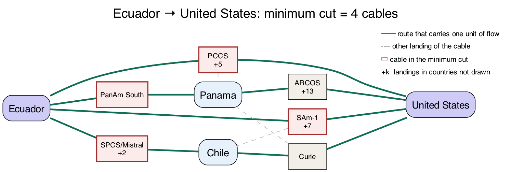
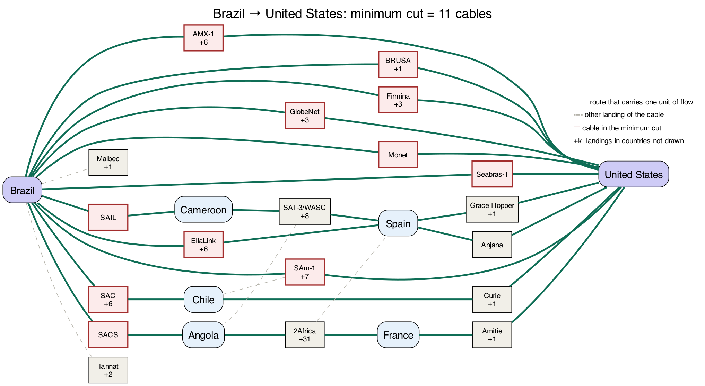
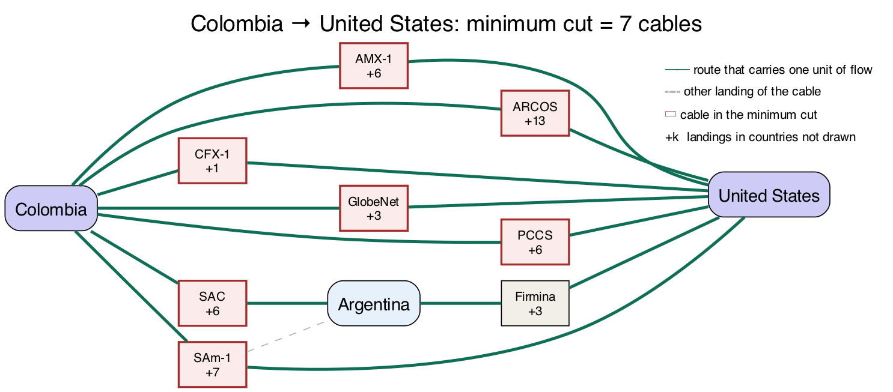
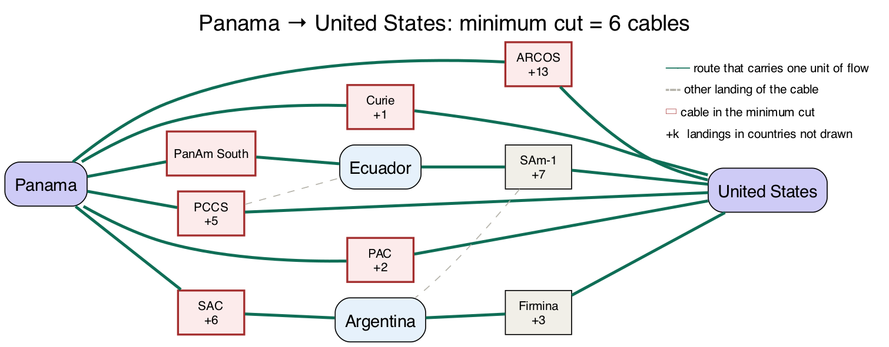
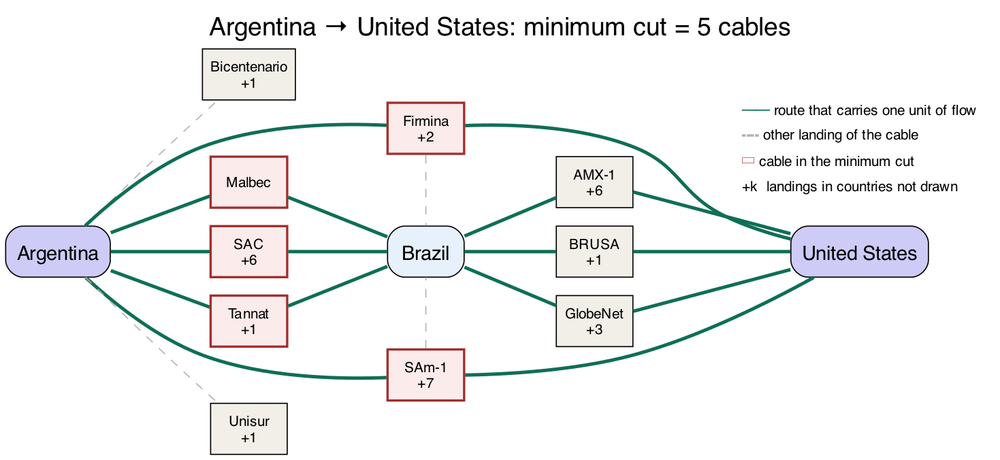
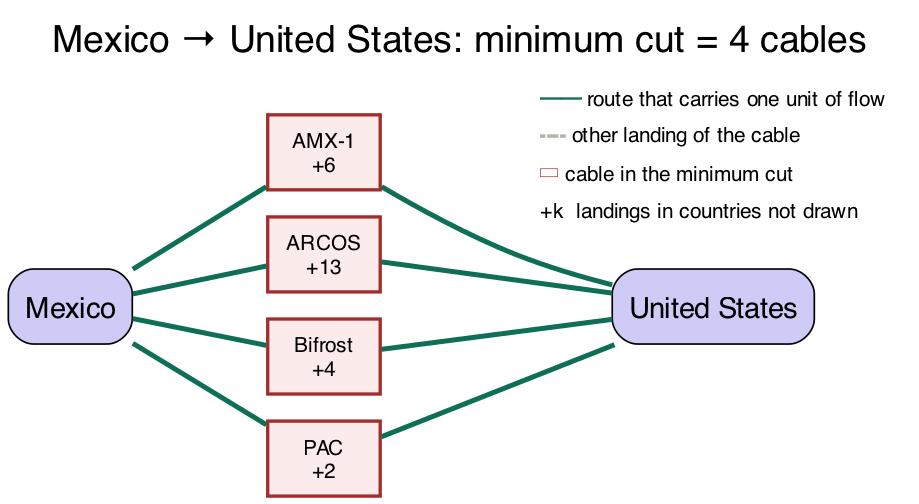
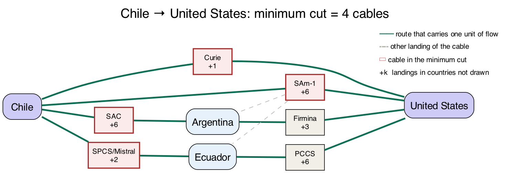
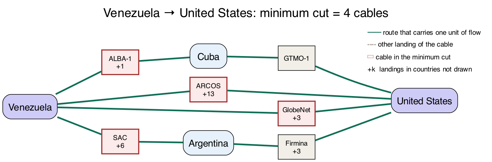
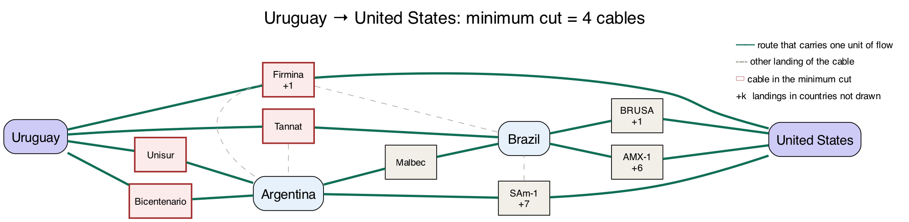
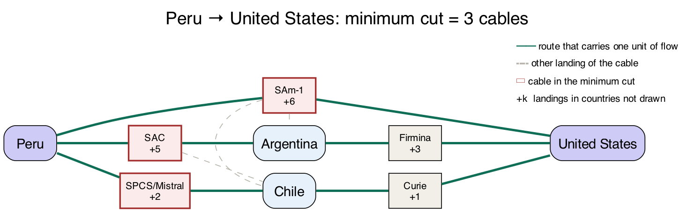

# Submarine cable resilience (min-cut)

How many submarine cables must fail, at minimum, to cut every submarine route
between a country and the United States? We model the cable network as a flow
network and compute an s-t minimum cut with max-flow (Edmonds–Karp), written
from scratch in [`cableflow/maxflow.py`](cableflow/maxflow.py).

Course: CMP 4007 Advanced Algorithms, USFQ.

## Model

```
country --∞--> c_in --1--> c_out --∞--> country
```

- **One node per country.** All landing points of a country are merged, which
  assumes a domestic terrestrial backbone that does not fail.
- **The US is split.** Alaska, Hawaii, Puerto Rico and the U.S. Virgin Islands
  are separate nodes. The sink `United States` is the contiguous states.
- **Each cable is two nodes** joined by an arc of capacity 1. That arc is the
  cable, so a cable costs 1 to cut regardless of how many countries it touches.
  Landing arcs have capacity ∞ and are never cut.
- **No land links between countries.** Only submarine routes count.
- **Active cables only** by default (`is_planned = False`, 608 of 714).
  `--include-planned` adds the rest.

By max-flow/min-cut (and Menger's theorem), the max flow equals both the number
of cable-disjoint routes and the minimum number of cables that must fail.

## Usage

```bash
python3 -m venv .venv && .venv/bin/pip install -r requirements.txt
.venv/bin/python -m cableflow Ecuador                  # one country
.venv/bin/python -m cableflow Chile --include-planned
.venv/bin/python -m cableflow.ranking                  # results/ranking.{csv,md}
.venv/bin/python -m cableflow.figures                  # figures/, needs Graphviz
.venv/bin/python -m pytest
```

Figures need the Graphviz `dot` binary (`brew install graphviz` or
`apt install graphviz`). Tests cross-check the max-flow against `networkx` on
random graphs and on the real network for the ten countries in the assignment.

The graph is built in sorted order, so every run gives the same routes and
cuts. The routes are one valid flow decomposition. Other decompositions with
the same number of routes exist.

## Results

### Ecuador → United States: 4 cables

All four cables that land in Ecuador must fail. The cut is unique: the
source-side and sink-side minimum cuts coincide.

| Cable-disjoint route |
|---|
| Ecuador → PCCS → United States |
| Ecuador → PanAm South → Panama → ARCOS → United States |
| Ecuador → SAm-1 → United States |
| Ecuador → SPCS/Mistral → Chile → Curie → United States |

With CSN-1 (planned, RFS 2026 Q4) the answer is 5.



### Ranking, most to least resilient

Countries with the same minimum cut share a rank. Within a tie, rows are
ordered by the minimum cut with planned cables, which does not change the rank.
Every minimum cut in the table is unique.

| Rank | Country | Min cut | With planned | Cables landing | Minimum cut (closest to source) |
|---:|---|---:|---:|---:|---|
| 1 | Brazil | 11 | 12 | 13 | AMX-1; BRUSA; EllaLink; Firmina; GlobeNet; Monet; SAC; SACS; SAIL; SAm-1; Seabras-1 |
| 2 | Colombia | 7 | 10 | 7 | AMX-1; ARCOS; CFX-1; GlobeNet; PCCS; SAC; SAm-1 |
| 3 | Panama | 6 | 10 | 6 | ARCOS; Curie; PAC; PCCS; PanAm South; SAC |
| 4 | Argentina | 5 | 5 | 7 | Firmina; Malbec; SAC; SAm-1; Tannat |
| 5 | Mexico | 4 | 8 | 4 | AMX-1; ARCOS; Bifrost; PAC |
| 5 | Chile | 4 | 6 | 4 | Curie; SAC; SAm-1; SPCS/Mistral |
| 5 | Ecuador | 4 | 5 | 4 | PCCS; PanAm South; SAm-1; SPCS/Mistral |
| 5 | Venezuela | 4 | 5 | 4 | ALBA-1; ARCOS; GlobeNet; SAC |
| 5 | Uruguay | 4 | 4 | 4 | Bicentenario; Firmina; Tannat; Unisur |
| 10 | Peru | 3 | 3 | 3 | SAC; SAm-1; SPCS/Mistral |

Argentina and Brazil are the only countries whose minimum cut is smaller than
their number of cables. Some of their cables (Bicentenario and Unisur for
Argentina, Malbec and Tannat for Brazil) only reach neighbors whose own exits
are already used, so they add no extra route. Uruguay's
minimum cut includes Bicentenario and Unisur, which only go to Argentina.

### Hypergraphs

Each cable is a hyperedge drawn as its incidence graph: a box linked to every
drawn country it lands in. Green lines are the cable-disjoint routes, red boxes
are the cables in the minimum cut, dashed lines are other landings, and `+k`
counts landings in countries not drawn. Every figure is in
[`figures/`](figures/) as PNG, SVG, PDF and Graphviz source.

| | |
|---|---|
|  |  |
|  |  |
|  |  |
|  |  |
|  | |

Full text output per country in [`results/`](results/).

### Most resilient country in the world

Same measure, run for all 184 regions with a submarine route to the
contiguous US (`python -m cableflow.world`, full table in
[`results/world_ranking.csv`](results/world_ranking.csv)). The last two
columns count landing stations and sites (stations within 25 km) instead of
cables, from [`cableflow.cuts`](docs/cuts.md).

| Rank | Country | Min cut (cables) | With planned | Cables landing | Unique cut | Stations | Sites ≤ 25 km |
|---:|---|---:|---:|---:|---|---:|---:|
| 1 | Singapore | 27 | 39 | 34 | yes | 6 | 1 |
| 2 | France | 24 | 29 | 24 | no | 13 | 12 |
| 3 | Japan | 23 | 31 | 24 | no | 15 | 10 |
| 3 | Indonesia | 23 | 30 | 23 | yes | 15 | 11 |
| 3 | United Kingdom | 23 | 26 | 51 | yes | 15 | 13 |
| 6 | Malaysia | 20 | 29 | 20 | no | 8 | 8 |
| 7 | Egypt | 16 | 22 | 17 | yes | 7 | 6 |
| 7 | India | 16 | 21 | 16 | yes | 7 | 7 |
| 7 | United Arab Emirates | 16 | 19 | 17 | no | 5 | 4 |
| 7 | China | 16 | 18 | 16 | yes | 15 | 8 |

By cables, Singapore is the most resilient. The result depends on what fails:

- **Stations.** Singapore's 34 cables land at only 8 stations, 18 of them at
  Tuas, so 6 stations disconnect it. By stations the top is the UK, Japan,
  Indonesia and China (15 each).
- **Sites.** At 25 km, Singapore's stations chain into one site
  (Tuas–Sakra–city–Katong–Tanah Merah–Changi), so a single local event cuts it.
  Single linkage exaggerates this, but the island is about 50 km wide.
- **Every cable weighs 1.** The data has no capacity, so a regional cable to
  Batam counts the same as a trans-Pacific one.
- **Transit is free.** Most of Singapore's routes reach the US through Japan,
  Europe or the Middle East. The model assumes those countries and their
  backbones never fail, and ignores land links (Singapore–Malaysia), which
  would only raise the cut.

## Data

[`data/`](data/) is a snapshot of TeleGeography's
[Submarine Cable Map](https://www.submarinecablemap.com) taken on 2026-11-12,
licensed CC BY-SA 4.0 (as cited in the assignment). Regenerate it with
`python3 scripts/fetch_submarine_cables.py`.

- `cables.csv`: one row per cable (length, RFS year, owners, countries).
- `cable_landing_points.csv`: one row per (cable, landing point), with
  coordinates. Landing points come in alphabetical order by country, not in
  route order.
